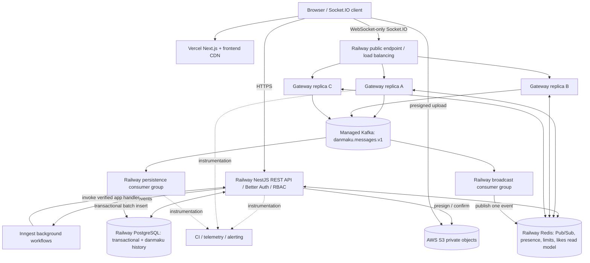
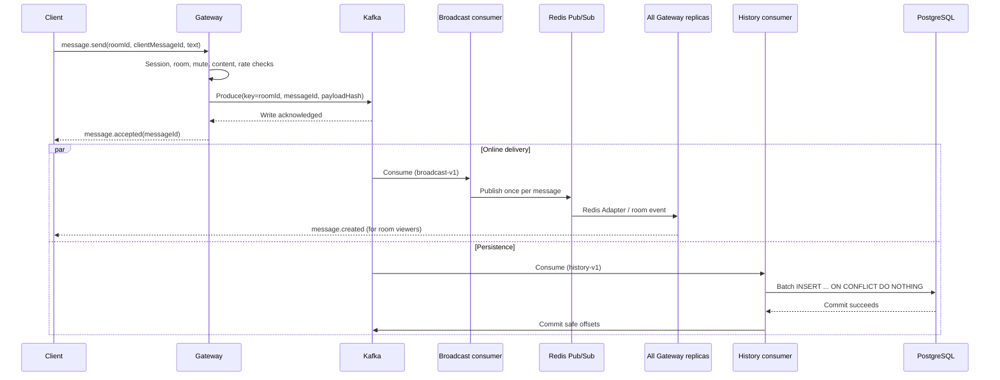

# LivePulse — Technical Architecture and Implementation Design

**Version:** 2.0 · **Date:** October 18, 2026
**Companion:** `LivePulse_Requirements_EN.md`
**Status:** Proposed architecture, not a report of deployed services or benchmark results.

## 1. Key decisions and rationale

1. **TypeScript monorepo:** Next.js App Router on Vercel, NestJS on Railway, shared Zod types in `packages/contracts`.
2. **One authoritative SQL store:** PostgreSQL + Prisma own identity/roles, rooms, likes, moderation, uploads, audit, outbox and **danmaku history**. MongoDB is removed from the target architecture.
3. **Durable event boundary:** Kafka accepts danmaku before the server reports `accepted`. Dedicated broadcast and persistence consumer groups independently handle online fan-out and batched SQL writes.
4. **Redis is not message history:** Redis Pub/Sub bridges Gateway replicas; Redis also stores rate-limit state, presence leases, optional room caches and **derived** like counts.
5. **Deployment split:** Vercel distributes the Next.js frontend/its eligible assets; Railway runs the backend, worker and hosted PostgreSQL/Redis; AWS S3 keeps files, with no implied S3 CDN from Vercel.
6. **Better Auth + custom RBAC:** Better Auth manages sessions, NestJS checks roles and ownership. Confirm integration and cookie/origin behavior under the chosen Fastify/Express adapter before finalizing implementation.
7. **Optional operational additions:** Inngest for low-rate durable workflows, GitHub Actions for CI, Sentry/OpenTelemetry/Grafana for visibility. Do not run complex infrastructure merely to list it on the résumé.

## 2. Architecture diagram



The Gateway replicas and API can run in **one NestJS Railway service initially**. Separate them only when HTTP and socket workloads warrant independent scaling. The broker should be a **managed Kafka deployment** or a clearly provisioned broker; Railway does not magically create Kafka when deploying a NestJS consumer. Keep broker, Redis, PostgreSQL and application regions close to reduce latency and egress cost.

## 3. Stack and learning boundary

| Layer            | Selected choice                                          | Purpose / operational caveat                                             |
| ---------------- | -------------------------------------------------------- | ------------------------------------------------------------------------ |
| Language/runtime | TypeScript strict + pinned supported Node.js LTS         | Common types and dependable reproducibility                              |
| Frontend         | Next.js App Router + React + Tailwind/shadcn/ui          | Vercel-hosted pages, responsive danmaku interface                        |
| Client API state | TanStack Query                                           | Mutations, cursor history queries, stale-state invalidation              |
| WebSocket        | NestJS Gateway + Socket.IO                               | Rooms, event acks, reconnection; Redis Adapter when replicas > 1         |
| Backend          | NestJS (Fastify or Express, integration tested)          | Modules, Controller/Service, authentication and authorization            |
| Contracts        | Zod; optionally OpenAPI-generated client                 | Runtime input validation and shared schemas                              |
| Authentication   | Better Auth                                              | Session cookies and user identity; no redundant DIY JWT stack by default |
| Authorization    | NestJS Guards + Service ownership checks                 | Role and resource-level permissions                                      |
| ORM/storage      | Prisma + PostgreSQL                                      | Transactional state and indexed, cursor-paginated history                |
| Redis            | node-redis / compatible client + Socket.IO Redis Adapter | Pub/Sub, token-bucket limits, leased presence, cached counters           |
| Kafka            | KafkaJS + externally provisioned Kafka                   | Accepted event log, partition ordering and independent consumers         |
| Files            | AWS SDK for JavaScript v3 + S3                           | Presigned POST/PUT, private objects, verified processing                 |
| Workflows        | Inngest, later phase                                     | Scheduled steps, retries, image processing and email                     |
| Local            | Docker Compose                                           | Dev postgres, redis, kafka, API, worker; optional local web              |
| Deploy           | Vercel and Railway                                       | Separate frontend/backend delivery; secrets and health checks            |
| CI               | GitHub Actions                                           | Lint/typecheck/test/build and gated production rollout                   |
| Observability    | Pino, Sentry, OpenTelemetry, Grafana Cloud               | Errors, tracing, service and message-pipeline metrics                    |

**Not required:** production Kubernetes, MongoDB, DynamoDB, Cloudflare Workers, a second frontend CDN, a Go service, separate microservices for every domain, or CloudFront in the initial version.

## 4. Railway services and infrastructure topology

| Railway service      | Replicas initial -> scale test              | External exposure                               | Depends on                              |
| -------------------- | ------------------------------------------- | ----------------------------------------------- | --------------------------------------- |
| `livepulse-api`      | 1 -> optionally 2                           | Public HTTPS REST; can host Socket.IO initially | PostgreSQL, Redis, Better Auth secrets  |
| `livepulse-gateway`  | Optional separate 1 -> 3                    | Public WSS Socket.IO                            | Redis, Kafka, auth/session DB           |
| `livepulse-consumer` | 1 persistence + 1 broadcast logical process | Private/background                              | Kafka, PostgreSQL/Redis                 |
| `postgres`           | 1 managed-service instance                  | Private only                                    | Persistent storage, backups             |
| `redis`              | 1 service initially                         | Private only                                    | Persistence/policy appropriate to usage |

If workers are split by role, use separate services or explicit commands so that scaling Gateway replicas **does not accidentally multiply scheduled jobs or standalone consumer groups**. For Socket.IO with multiple Railway replicas and no sticky sessions, constrain both client and server to `transports: ['websocket']`; long-polling fallback then is unavailable. Redis Adapter connects broadcast rooms, but doesn't guarantee message replay or automatic room rejoin.

### Environment variables (examples, not secrets)

```dotenv
NODE_ENV=production
APP_ORIGIN=https://app.livepulse.com
API_ORIGIN=https://api.livepulse.com
DATABASE_URL=postgresql://...private-railway-connection...
REDIS_URL=redis://...private-railway-connection...
KAFKA_BROKERS=broker1:9092,broker2:9092
KAFKA_TOPIC_DANMAKU=danmaku.messages.v1
BETTER_AUTH_SECRET=replace-in-secret-store
AWS_REGION=ca-central-1
S3_UPLOAD_BUCKET=livepulse-media-private
INNGEST_SIGNING_KEY=replace-in-secret-store
SENTRY_DSN=optional
```

Actual domains, Railway variables and broker TLS/SASL credentials depend on the chosen accounts and provider. Never embed credentials or fixed developer fallback secrets in production images.

## 5. Danmaku ingestion, fan-out and persistence



**Definition of success:** accepted = Kafka append acknowledged (according to producer acknowledgement configuration); persisted = PostgreSQL transaction committed; delivered = observed by specific client only when client-side receipt is measured. Do not conflate these states.

**Kafka settings (initial design, benchmark later):** one `danmaku.messages.v1` topic, 6 partitions, 24-hour retention, `roomId` as key, `broadcast-v1` and `history-v1` separate consumer groups; use stable `messageId` and `clientMessageId` for retries. Preserve per-room Kafka ordering only within stable partition mapping; changing partition count can change key mapping, requiring deliberate migration. One extremely hot room maps to one hot partition and needs special mitigation if measured.

**Persistence worker:** poll batches, write via Prisma `createMany({skipDuplicates:true})` where supported or raw SQL bulk insert, commit offsets only after the DB transaction and only for contiguous successfully processed records. On database outage, retry/back off without advancing offsets. Bad permanent payloads enter reviewed DLQ handling and alerts; temporary DB failures are not DLQ'd immediately. Unique IDs and payload-hash mismatch handling prevent a retry from silently altering the original content.

**Redis fan-out:** Redis Pub/Sub is an at-most-once online distribution path. With Socket.IO Redis Adapter, one server publish fans out to the room across all connected replicas; **do not let every replica re-broadcast the same Kafka event independently**. Offline clients recover through SQL history. Implement frontend deduplication against optimistic send and replay.

**Simpler M0 alternative:** a single Gateway emits directly via Socket.IO and saves danmaku in PostgreSQL; no Redis Pub/Sub is needed until multiple Gateway replicas. Keep a message-service boundary so M1 switches to Kafka without changing frontend event names. Avoid dual writing Kafka and direct SQL concurrently without a conscious migration protocol.

## 6. PostgreSQL schema and indexes

Key entities; keep exact migrations checked into the repository:

| Table                        | Important fields                                                                                                                                      | Integrity/index requirement                                                                           |
| ---------------------------- | ----------------------------------------------------------------------------------------------------------------------------------------------------- | ----------------------------------------------------------------------------------------------------- |
| `users` / Better Auth tables | user identity, email, session/account                                                                                                                 | Follow Better Auth schema and indexes, no duplicate homegrown auth store                              |
| `user_roles` or `users.role` | role                                                                                                                                                  | Server-owned, validated                                                                               |
| `rooms`                      | `id`, `host_id`, `status`, `cover_asset_id`, `version`, timestamps                                                                                    | index on visibility/status and `(created_at,id)`                                                      |
| `danmaku_messages`           | `id`, `room_id`, `user_id`, `client_message_id`, `body`, `accepted_at`, `kafka_partition`, `kafka_offset`, `payload_hash`, `deleted_at`, `expires_at` | unique `id`; unique `(room_id,user_id,client_message_id)`; index `(room_id,accepted_at DESC,id DESC)` |
| `room_likes`                 | `room_id`, `user_id`, `created_at`                                                                                                                    | composite PK/unique `(room_id,user_id)`                                                               |
| `room_mutes`                 | `room_id`, `user_id`, `expires_at`, `muted_by`                                                                                                        | unique `(room_id,user_id)` and expiry lookup                                                          |
| `reports`                    | reporter, message, room, reason/status                                                                                                                | uniqueness policy for duplicate reports                                                               |
| `audit_logs`                 | actor, action, target, created_at                                                                                                                     | indexed admin history                                                                                 |
| `media_assets`               | owner, room, S3 object key, MIME, bytes, state                                                                                                        | unique object key; `PENDING/SCANNING/READY/REJECTED`                                                  |
| `outbox_events`              | event_id, aggregate, payload, published_at, attempts                                                                                                  | unique event ID and due-events index                                                                  |

Illustrative Prisma model (adapt to actual auth/room IDs):

```prisma
model DanmakuMessage {
  id              String    @id
  roomId          String
  userId          String
  clientMessageId String
  body            String    @db.VarChar(200)
  acceptedAt      DateTime
  kafkaPartition  Int?
  kafkaOffset     BigInt?
  payloadHash     String
  deletedAt       DateTime?
  expiresAt       DateTime?

  @@unique([roomId, userId, clientMessageId])
  @@index([roomId, acceptedAt(sort: Desc), id(sort: Desc)])
  @@index([expiresAt])
}
```

`acceptedAt` + `id` gives deterministic keyset pagination; Kafka partition/offset are operational metadata, **not a global ordering key across partitions**. A monotonic per-room playback sequence requires additional coordination if strict presentation order is mandatory. Use bounded retention/deletion jobs and consider PostgreSQL time-range partitioning only after size/retention benchmarks. Moderation tombstones must not be recreated by stale Kafka replay, and hard deletion must consider reporting/audit policy.

### Why PostgreSQL, not MongoDB for v2 history?

| Question                                 | PostgreSQL                                     | MongoDB                                                      |
| ---------------------------------------- | ---------------------------------------------- | ------------------------------------------------------------ |
| Fixed message schema + room/time history | Excellent with composite index/keyset cursor   | Also good with compound indexes                              |
| Relations to user, room, reports, mutes  | One database, FK/transaction support           | Usually application-level joins or additional queries        |
| Duplicate Kafka consumer replays         | `UNIQUE` + `ON CONFLICT`                       | Unique index + upsert                                        |
| High-volume append throughput            | Can be good if schema/index/partitioning tuned | Can be good; depends on workload/sharding                    |
| TTL / lifecycle                          | Scheduled deletes or partitions                | Native TTL index convenient, asynchronous                    |
| Operational cost in this project         | Reuse existing Railway PostgreSQL and Prisma   | Adds a second database, client, backup and consistency story |

**Decision:** PostgreSQL is preferable for LivePulse's present workload and learning budget. MongoDB is defensible if message documents become very flexible, have independently scaling document-heavy retention needs, or a measured workload shows operational advantages; it is **not inherently faster for all chat writes**. Avoid prematurely claiming either database has superior throughput without benchmarking the actual data and indexes.

## 7. Redis design: four responsibilities, no unnecessary source of truth

| Use                     | Proposed keys/channel                                                            | Correctness/recovery                                                                        |
| ----------------------- | -------------------------------------------------------------------------------- | ------------------------------------------------------------------------------------------- |
| Cross-replica broadcast | Socket.IO Redis Adapter Pub/Sub (adapter-managed channels)                       | Not persisted; reconnect to PostgreSQL history                                              |
| Danmaku rate limiting   | `rate:room:{roomId}:user:{userId}`                                               | Atomic Lua script/token bucket, TTL, metrics and degraded policy                            |
| Presence leases         | `presence:room:{roomId}` sorted set + `conn:{connectionId}` user/replica mapping | Heartbeat/lease, expiry cleanup, dedupe users across tabs                                   |
| Likes read model        | `likes:room:{roomId}:count`                                                      | **PG `room_likes` is truth**; invalidate/rebuild from SQL; no blind INCR as source of truth |
| Optional cache          | `room:{roomId}:metadata`                                                         | short TTL + explicit invalidation on updates                                                |

**Likes race-condition strategy:** PostgreSQL `INSERT .. ON CONFLICT DO NOTHING` or delete under uniqueness is authoritative. Publish an outbox event in the same DB transaction; consumer invalidates or refreshes Redis after commit. A naive async `COUNT` refresh can arrive out of order; serialize refresh per room, associate versioning, or invalidate then refill. If Redis crashes, recompute count from SQL. `INCR` alone does not prevent duplicate likes.

**Presence semantics:** unique online users != open connections. A user in three tabs contributes three connections and one unique user. A clean disconnect removes its lease; an unclean crash expires after bounded time. Redis sorted-set scans can be expensive in huge rooms; use aggregated counters/shards only after measurements. Never promise exact instantaneous online counts.

**Single instance?** Redis Pub/Sub is unnecessary for local Socket.IO broadcasting; use the server's in-memory rooms in M0. Redis still can support shared limits/derived counters if the benefits justify a separate service.

## 8. Authentication, RBAC and WebSocket security

- Better Auth mounted behind the NestJS HTTP adapter, with tested runtime/database adapter compatibility and secure sessions. Define trusted origins. Avoid unreviewed dual-cookie/dual-JWT implementations.
- Backend origin: `https://api.livepulse.com`; frontend: `https://app.livepulse.com`; configure CORS `credentials`, `SameSite`, `Secure`, explicit Origin enforcement, CSRF defenses on mutations and auth endpoints.
- WebSocket upgrade validates session and Origin; per-event `roomId` access/membership, account status, mute and rate-limit policies rechecked. A valid socket connection **does not authorize all rooms or all future messages**.
- Roles: `guest`, `viewer`, `host`, `admin`. Host must own a room; authorization must happen server-side. Apply audit trails to moderation/role changes.
- Reconnection revalidates session and rejoins only authorized rooms. If a session is revoked, disconnect/reject further messages.

## 9. S3 secure upload and approved media lifecycle

```mermaid
sequenceDiagram
 participant B as Browser
 participant A as Railway NestJS
 participant S as AWS S3 private bucket
 participant W as Inngest / processing worker
 participant P as PostgreSQL
 B->>A: Request upload permission (roomId, type, size)
 A->>A: Session + host ownership + quota
 A->>P: Create PENDING media_assets row
 A-->>B: Short-lived constrained presigned POST/PUT
 B->>S: Upload bytes directly to quarantine key
 B->>A: Complete(uploadId)
 A->>S: HEAD object; check size / metadata
 A->>W: Start scan / decode / re-encode workflow
 W->>S: Validate content and promote approved object
 W->>P: Mark READY or REJECTED
```

S3 bucket blocks public access. Private IAM credentials stay on the server; browser receives only limited presign capability. Validate file extension and declared MIME **and actual bytes/content**; impose enforceable upload limits, random non-overwritable keys, short expiries and upload/presign rate limits. Process unsafe assets outside the public path. Use bucket lifecycle rules for stale `PENDING` uploads. Verify AWS costs and use of egress between Railway and S3. CloudFront is optional, not required if Vercel is the chosen frontend CDN; media delivery must still be explicitly designed.

## 10. Inngest and background business workflows

Good candidates: after approved upload, generate thumbnail; notify followers when a room goes LIVE; daily analytics rollup; abandoned-upload cleanup. Use verified Inngest handlers and per-step retry limits. Retries require idempotency keys for external side effects. **Kafka consumer remains the danmaku fast path**, not Inngest per-message execution. Transactional Outbox may connect a committed room state transition to eventual workflow event emission without losing the event on API crash.

## 11. CI/CD, migrations and deployments

```text
Pull Request -> GitHub Actions: install locked deps -> lint -> typecheck
  -> unit tests -> integration tests (ephemeral PostgreSQL/Redis/Kafka)
  -> Playwright key user journey -> build validation
Merge to main -> publish/deploy Vercel + Railway (single deployment owner)
  -> controlled prisma migrate deploy -> health + smoke tests
  -> monitor regressions -> document rollback
```

Choose either Railway/Vercel's connected-GitHub deployment integration **or** an explicit GitHub Actions deployment workflow per service; don't accidentally deploy twice. Use preview/staging isolation and protected production secrets. Application image rollback does not undo destructive SQL migrations: follow expand/migrate/contract. Keep `main` gated by CI. Pin Node/pnpm/lockfiles and Docker base versions. Railway multiple replicas need readiness checks and graceful shutdown so clients reconnect; do not treat a killed WebSocket as transferable to another pod/process.

## 12. Observability and operational SLO-style goals

| Signal                                            | Source                        | Why it matters                  |
| ------------------------------------------------- | ----------------------------- | ------------------------------- |
| HTTP error rate, P95 latency                      | NestJS OTel + Sentry          | API regressions                 |
| Active sockets + reconnection rate                | Gateway metrics               | Capacity / deployment stability |
| Accepted messages/s and ACK P95                   | Gateway + Kafka producer      | User-facing ingestion latency   |
| Kafka consumer lag and oldest event age           | Broker/consumer               | Persistence backpressure        |
| Persistence batch size / duration / failures      | History consumer + PostgreSQL | DB write bottleneck             |
| Redis errors / limiter rejects / publish failures | Redis instrumentation         | Fan-out and abuse safeguards    |
| Presence unique-user estimate                     | Redis snapshots               | Room experience                 |
| Like cache rebuild / mismatch                     | Stats worker                  | Derived count correctness       |
| Upload rejection/scanning time                    | API / worker / S3             | Storage security and UX         |
| Inngest workflow failure/retry                    | Inngest dashboard             | Background tasks                |

Use correlated `requestId` / `messageId` in structured logs and tracing metadata but avoid high-cardinality per-user/room Prometheus labels. Kafka producer-to-consumer waits need message timestamp/tracing propagation; they do not automatically appear in a single HTTP trace. Redact session cookies, tokens, S3 URLs and PII. A useful first dashboard includes ACK latency, consumer lag, active sockets, WebSocket delivery attempts, DB pool load and app 5xx rate.

## 13. Reliability and failure matrix

| Failure                                           | Correct behavior / verification                                                                    |
| ------------------------------------------------- | -------------------------------------------------------------------------------------------------- |
| Kafka broker unreachable                          | Gateway refuses/timeout on new accepted ACK; no false success; reconnect/retry same message ID     |
| Persistence consumer crashes before offset commit | Kafka redelivers; PostgreSQL uniqueness prevents duplicates; no offset skipped                     |
| PostgreSQL temporarily unavailable                | Kafka accumulates until retention/capacity threshold; alerts and admission control; later catch-up |
| Redis Pub/Sub interrupted                         | Clients can miss live events; degraded banner/metric; history reconciliation after reconnect       |
| Redis rate limiter interrupted                    | Restrictive fallback or reject sends; no unbounded abuse                                           |
| Gateway replica killed                            | Client reconnects, reauthenticates and rejoins; presence lease expires                             |
| Delayed duplicate like event                      | Derived Redis count corrected/rebuilt from PostgreSQL                                              |
| S3 invalid/oversized object                       | Quarantined and rejected; never public; cleanup policy                                             |
| Inngest step retried                              | Idempotent side effects, no duplicate emails/assets                                                |
| Destructive migration proposal                    | Expand-and-contract, restore path and staged deployment instead of blind rollback                  |

## 14. Testing and load-test plan

- **Unit:** roles, ownership, state transitions, Zod schemas, stable IDs, token bucket, cursor decoding.
- **Integration:** Better Auth session + cookie flow, SQL unique likes, Kafka duplicate persistence with same message ID, stale moderation replay, Redis cross-instance fan-out, S3 upload authorization.
- **E2E:** viewer login; host create/live/ended; two browsers send and receive; pagination; mute/delete/report; picture upload rejection and success; reconnect recovery.
- **Failure:** kill a Gateway replica, Redis failure, Kafka backlog, restart consumer after SQL commit but before offset commit, failed Inngest image step.
- **Load:** record connections, room distribution, inbound rate, delivered copies, socket memory, P95 ACK/delivery, DB batch insert throughput and lag. Use k6 and/or a Socket.IO-capable load generator; a raw WS script without Socket.IO framing is not an equivalent test.
- **Targets (unverified):** 1,000 idle connections; 100 incoming msg/s / 10 rooms with P95 acceptance <300 ms; 20 incoming msg/s / 1,000-user hot room and expected ~20,000 send attempts/s; 500 msg/s brief burst with bounded lag and recovery; zero duplicate SQL history rows after replay. Publish raw test logs and methodology.

## 15. Suggested monorepo and developer workflow

```text
livepulse/
  apps/
    web/                    # Next.js frontend -> Vercel
    api/                    # NestJS HTTP/auth/initial socket gateway -> Railway
    gateway/                # optional independently scaled Socket.IO process
    worker/                 # Kafka broadcast + history + outbox roles
  packages/
    contracts/              # Zod DTOs, Socket.IO event schemas, error codes
    db/                     # Prisma schema, migrations and SQL client
    config/                 # typed environment validation
    observability/          # logging, tracing, metrics helpers
  infra/
    compose/                # local postgres, redis, kafka, apps
    railway/                # Railway per-service config and notes
  .github/workflows/        # CI pipelines
  tests/{unit,integration,e2e}/
  benchmarks/               # Socket.IO load and failure tests
  docs/                     # PRD, architecture, API, deployment, ops, results
```

**Build order:** (1) local SQL CRUD/auth; (2) single-gateway chat/likes; (3) Kafka + SQL batch consumer; (4) Redis replica fan-out, presence and limits; (5) S3; (6) Vercel/Railway + CI + telemetry; (7) optional Inngest and larger load tests. Each phase should be independently runnable and observable.

## 16. Migration notes from original design

| Original v1                                  | Updated v2                                   | Required action                                                                                           |
| -------------------------------------------- | -------------------------------------------- | --------------------------------------------------------------------------------------------------------- |
| MongoDB history + PostgreSQL business tables | PostgreSQL for both                          | Remove MongoDB driver, indexes and TTL design; introduce SQL message model, keyset paging, retention jobs |
| Direct MongoDB writes in Phase A             | Direct SQL writes in M0                      | Keep stable IDs; migrate to Kafka before `accepted` semantics in M1                                       |
| Native `ws` gateway and raw envelopes        | NestJS + Socket.IO                           | Update client transport, room event names, tests, load generator; verify adapter and session handling     |
| EC2 + Docker Compose public deployment       | Vercel + Railway, AWS S3                     | Rework DNS, secrets, migrations, networking, backups and release workflows                                |
| AWS ECR pipeline / later k3s                 | GitHub Actions + platform deployments        | Remove ECR dependency unless adopted for a separate AWS exercise                                          |
| Redis stats via Kafka worker                 | PostgreSQL source + Redis derived read model | Explicit invalidation/rebuild and concurrency semantics                                                   |
| No S3 media lifecycle                        | Private S3 quarantine / verify / approve     | Add media DB states, IAM, upload security tests and cleanup                                               |

## 17. Documentation and source references

Baseline: supplied `LivePulse_Requirements_EN(1).md` and `LivePulse_Technical_Stack_EN(1).md`, both v1.0 (October 8, 2026). V2 design decisions reflect the owner's requested new architecture and are not claims of measured operation. Verify provider-specific behavior, pricing, product limits and SDK compatibility during implementation using: [Railway docs](https://docs.railway.com/), [Vercel docs](https://vercel.com/docs), [Better Auth](https://www.better-auth.com/docs), [Socket.IO Redis adapter](https://socket.io/docs/v4/redis-adapter/), [Kafka documentation](https://kafka.apache.org/documentation/), [Redis documentation](https://redis.io/docs/latest/), [AWS S3 presigned uploads](https://docs.aws.amazon.com/AmazonS3/latest/userguide/PresignedUrlUploadObject.html), [Inngest documentation](https://www.inngest.com/docs), and [PostgreSQL docs](https://www.postgresql.org/docs/).
